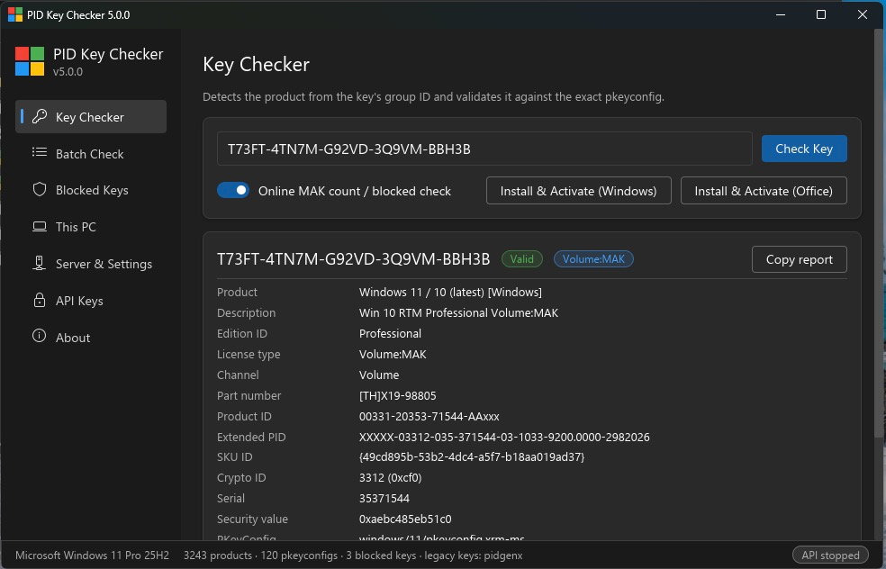

# PID Key Checker 5

A Rust rewrite of PID Key Checker for Windows: it validates Microsoft product keys offline, shows the product, edition, channel and IDs, checks remaining MAK activations and blocked status with Microsoft, and exposes everything through a Fluent-style desktop app (Iced), a CLI and a REST API (actix-web).



## Features
- Offline validation of Windows, Windows Server, Office, SQL Server, Exchange, SharePoint, Visual Studio and other Microsoft keys, against 120 pkeyconfig files (3,243 products).
- Detects the product directly from the key. For Windows 8+ / Office 2013+ keys, the group ID is decoded and looked up in an index, so a check takes microseconds.
- Legacy Vista / 7 / Office 2010 keys are verified through Microsoft's `pidgenx.dll`.
- Full details per key: product, description, edition, license type and channel, part number, Product ID, Extended PID, SKU ID, Crypto ID, serial and security value. There's also a plain-language note on what the key type can do (Retail, OEM, MAK, GVLK, CSVLK).
- Online lookup through Microsoft's activation service: remaining MAK activations, and whether the key is blocked (`0x67`).
- Batch checking. Paste any text and the keys are found automatically. Offline checks run in parallel, online lookups are grouped into a few requests, and progress is shown per key.
- A result cache with configurable lifetime and size.
- Explanations for activation error codes (`0xC004C003`, `0xC004F074`, …), taken from Microsoft's support documentation.

**Blocked keys**
- A fast embedded database (redb) of blocked keys.
- Keys are added automatically when Microsoft reports them blocked or when they belong to a revoked key range.
- Admins can add, remove and look up keys singly or in batches, from the GUI, the CLI or the REST API.

**Desktop app**
- A Fluent 2 (Windows 11) style interface: Segoe UI Variable, Fluent icons, dark theme.
- Key checker, batch check with a clickable full report per key, blocked keys, and settings.
- *This PC*: the Windows and Office licenses installed on this machine, plus install and activate a key in one click.
- Runs the REST server from the GUI, and manages API keys and settings.
- Runs without a console window, and only one instance runs at a time.
- Checks GitHub for a newer release in the background and offers to open the download page.

**REST API and CLI**
- An actix-web REST API with single, batch, blocklist, error-code and API-key endpoints.
- Opaque API keys (`pkc_…`) with user and admin roles, expiry, and usage tracking. Only hashes are stored.
- Standard rate limiting (GCRA) per key or per IP, with `RateLimit-*` and `Retry-After` headers and optional per-key limits.
- `pkc` console tool: run the server headless with request logs, check keys, and manage API keys, the blocklist and configuration.
- Configured through a single `config.toml` next to the executable.

## How a key is checked

1. **Detect the product from the key.** Windows 8+ / Office 2013+ keys (`pkey2009`, they contain one `N`) are decoded natively. The group ID (Crypto ID), serial and checksum come out of the key itself, and the group is looked up in an index of every pkeyconfig built at startup. One check takes a few microseconds, and a 500-key batch about 1 ms.
2. **Legacy keys** (Vista / 7 / Office 2010, `pkey2005`) can only be verified by Microsoft's `pidgenx.dll`. The key's group can't be read from it, so the files are tried in a planned order: native legacy products first, and newer files only when their legacy ranges add something. The most recently matched file is tried first. Each PidGenX call is deliberately CPU-expensive (15–35 s), so batches run several DLL instances in parallel and results are cached.
3. **Blocklist.** Every key is looked up in the blocked-keys database (redb).
4. **Online lookup** (optional). MAK keys are sent to Microsoft's BatchActivation service, many PIDs per request, to get the remaining activation count. Error `0x67` means the key is blocked; it is shown and recorded automatically.

## Run

Two executables are built from the same code:

- **`pidkeychecker.exe`**: the desktop app. It's a Windows GUI-subsystem program, so no console window appears.
- **`pkc.exe`**: the console tool for the headless server and for management.

```bash
pkc serve [--host 0.0.0.0] [--port 8080] [--log-level debug]   # REST API only, request logs on the console, Ctrl+C stops
pkc status                                      # health of a running server
pkc check KEY [KEY...] [--offline] [--json]     # or pipe any text: type keys.txt | pkc check
pkc apikey create --name admin --role admin [--expires-days 90] [--rate-limit 600]
pkc apikey list | revoke ID | delete ID | rate-limit ID 600
pkc blocklist count | add KEY... [--note "ticket 42"] | remove KEY... | check KEY...
pkc config show | path
pkc error 0xC004C003                            # explain an activation error code
```

Only one GUI or server runs per data folder. The blocked-keys database can be opened by a single process, so the app holds an exclusive OS lock on `pidkeychecker.lock` next to `config.toml`. A second instance is refused and told the running one's PID. While an instance is running, manage it through its REST API or GUI.

`config.toml` is read from the executable's folder, falling back to the current directory; `-c` overrides it. Relative paths inside it are resolved against the config file. Next to the exe you need `data/` (pkeyconfigs and `catalog.toml`), and optionally `pidgenx.dll`. The blocked-keys database `blocked.redb` is created empty. It fills from Microsoft's verdicts (`0x67`), from revoked key ranges, and from admin additions via the GUI, the CLI or `POST /blocklist`.

## REST API

Base URL `http://host:port/api/v1`. Authenticate with `Authorization: Bearer pkc_…` or `X-API-Key: pkc_…`.

| Method | Path | Role |
|---|---|---|
| GET | `/health` | none |
| GET | `/check/{key}?online=true` | user |
| POST | `/check` `{"key": "...", "online": true}` | user |
| POST | `/check/batch` `{"keys": [...], "online": false}` | user |
| GET | `/errors`, `/errors/{code}` | user |
| GET | `/blocklist`, `/blocklist/{key}` | user |
| POST | `/blocklist` `{"keys": [...], "note": "..."}` | admin |
| POST | `/blocklist/remove` `{"keys": [...]}` | admin |
| DELETE | `/blocklist/{key}` | admin |
| GET / POST | `/apikeys` `{"name", "role", "expires_in_days"}` | admin |
| POST | `/apikeys/{id}/revoke` | admin |
| PUT | `/apikeys/{id}/ratelimit` `{"requests_per_minute": 600}` | admin |
| DELETE | `/apikeys/{id}` | admin |

API keys are opaque tokens (`pkc_` + 256 random bits). Only their SHA-256 hash is stored, in `api_keys.json`.

**Rate limiting** uses GCRA (a token bucket) per API key, or per IP when no key is sent. Every response carries `RateLimit-Limit`, `RateLimit-Remaining`, `RateLimit-Reset` and `RateLimit-Policy`; a rejected request gets `429` with `Retry-After`. Each key can have its own limit.

## Configuration (`config.toml`)

| Section | Key | Default | Meaning |
|---|---|---|---|
| server | host, port | 127.0.0.1, 8080 | bind address |
| server | autostart | false | start the API when the GUI opens |
| server | cors | false | allow browser cross-origin calls |
| rate_limit | enabled, requests_per_minute, burst | true, 120, 30 | per-client quota |
| rate_limit | trust_proxy_headers | false | use `X-Forwarded-For` (only behind a proxy) |
| checker | max_batch_size | 500 | keys per batch (API and GUI) |
| checker | online_check | true | query Microsoft by default |
| checker | online_key_types | ["MAK"] | key types sent online (`"*"` = all) |
| checker | online_chunk_size, online_concurrency | 25, 4 | PIDs per request, parallel requests |
| checker | record_blocked, record_revoked | true, true | auto-add keys Microsoft reports blocked or that fall in revoked ranges |
| checker | cache_enabled, cache_ttl_secs, cache_max_entries | true, 3600, 100000 | result cache |
| checker | blocklist_db | blocked.redb | blocked-keys database |
| checker | pidgenx_path, pidgenx_instances | pidgenx.dll, 0 | legacy backend (0 = one instance per CPU core) |
| api | require_auth, keys_file | true, api_keys.json | |
| app | check_updates | true | check GitHub for a newer release a few seconds after the GUI starts |

## Data

`data/` is organised as `<category>/<product>/pkeyconfig[-csvlk|-downlevel|-kmshost].xrm-ms`. `data/catalog.toml` names each product and sets lookup priority. Files that aren't in the catalog are still loaded, after the listed ones. Error-code explanations come from Microsoft's licensing-and-activation support articles (`docs/activation-error-codes.json`) and are embedded in the binary.

## Build

```bash
make dist           # Windows ARM64 + x64 packages (exe, pkc, data, config) in target/dist/, plus zips
make e2e            # build ARM64, deploy to the Parallels VM "Windows 11" (C:\pkc-e2e), run smoke tests
make vm-gui         # start the deployed GUI in the VM user session
make test lint      # unit/integration tests, clippy
```

**Releases** are built by GitHub Actions (`.github/workflows/release.yml`). Pushing a version tag that matches `Cargo.toml` runs the tests, builds the x64 and ARM64 packages, and publishes them to a GitHub release with SHA-256 checksums:

```bash
git tag v5.0.0 && git push origin v5.0.0
```

Or with cargo directly:

```bash
cargo build --release                                       # native
cargo xwin build --release --target x86_64-pc-windows-msvc  # Windows x64 from macOS/Linux
cargo xwin build --release --target aarch64-pc-windows-msvc # Windows ARM64
cargo build --release --no-default-features                 # headless (no GUI)
cargo test
```

Windows builds link the C runtime statically (`.cargo/config.toml`), so no VC++ redistributable is needed. `pidgenx.dll` must match the exe's architecture; if it doesn't, the app falls back to `%WINDIR%\System32\pidgenx.dll`.
